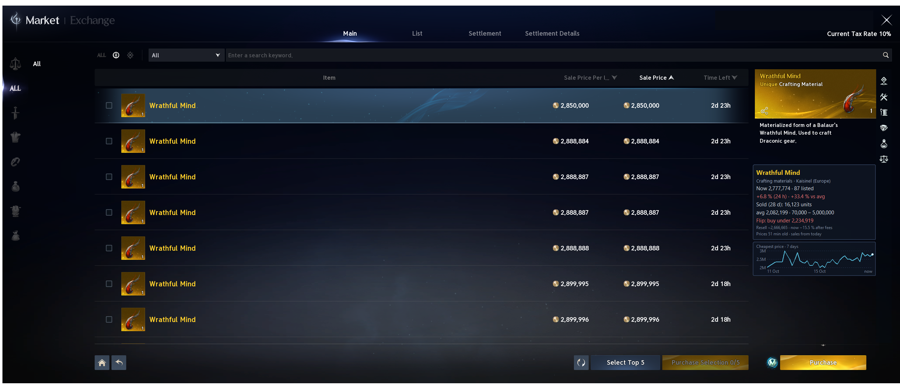

# AION 2 Market Overlay

Select an item in the AION 2 market and a box appears below the detail panel with reference prices from
[aion2.exchange](https://aion2.exchange).

- Cheapest price now, listings, change over 24 hours, units sold, age of the data
- Price graph of the last 7 days
- Flip advice ("buy under ...") after the market's fees
- Kina chests of the Quna market, with a check whether now is a good moment to exchange
- Works at any screen size, server selectable (default Kaisinel, Europe)

It only reads pixels from the screen and shows a window on top of the game: no game memory, no input, no network
sniffing. Unofficial tool, not affiliated with NCSOFT; you use it at your own risk.

## Download and start

1. Download `AION-2-Market-Overlay.exe` from the [latest release](../../releases/latest) and start it. Nothing to
   install. Windows may warn about an unknown publisher because the file is not signed ("More info", "Run anyway").
2. Start the game, open the market and select an item.

You need Windows 10 or 11, the game in **borderless window** mode, and the Windows text recognition language
**English**. If that is missing the program says so: add it in *Settings > Time & language > Language & region >
Add a language > English (United States)* and tick "Optical character recognition". Your display language can stay
as it is.

## Screen setup

At 21:9 and 16:9 nothing is needed, the program knows the market's layout. For any other window shape (16:10, 4:3 ...)
it offers a one-time setup, or press **Set up screen areas...** in the settings window:

1. Open the market and select any item.
2. The screen freezes. Drag a rectangle around the **market title** ("Market | Exchange", top left), then around the
   **item name** in the detail panel (top right), then where the **info box** should appear (a free spot, for example
   below the detail panel). Backspace takes back the last rectangle, Esc cancels.
3. The program checks that it can read the title and an item name.

## More

- [Details](docs/details.md): settings, how it works, the flip advice, Kina chests, config values

This repository is the download page. The source code is not published.
